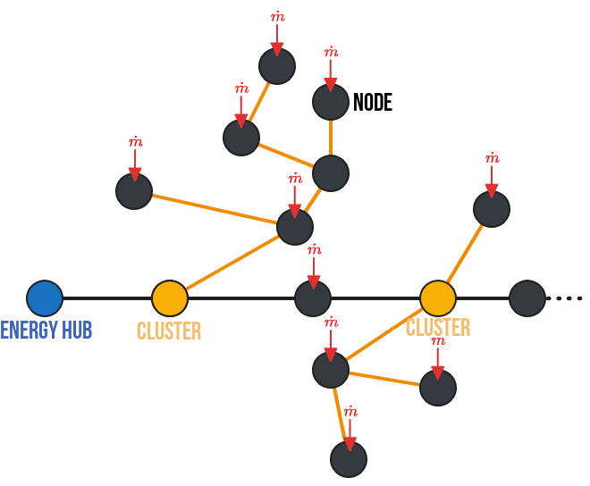
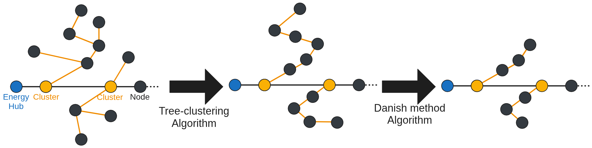

# Documentation

## 1. Defining network

### 1.1 Topology formalism

The first methodological step when using the PipingTool is to define the network. This involves formalizing the network in a language that is, on the one hand, understandable to humans and, on the other, flexible and logical for the machine. Let’s review a few terms and methods frequently used to formalize heating networks. Complex networks are mathematically represented by directed graphs (Lickeder et al. [^1]). A directed graph G is a pair (N, E) consisting of N, the set of junctions (called nodes), and E, the set of pipes (called edges). Edges can be considered as pairs of two nodes (N_{i}, N_{j}) or N_{i}, N_{J} \in N. Edges are therefore directed: they are arrows pointing from one node in the network to another. To indicate a flow in the opposite direction of this arrow, negative flow rates can be assigned. However, this method is risky when working in the TRNSYS environment, which only considers positive flow rates in all of its components. Finally, we will assume that the entire system is symmetrical in terms of its physical behavior: the same flow rates pass through the supply and return pipes. We will size them identically, assuming an average temperature $T=(T_{supply}-T_{return})/2$. Thus, two networks will be defined and sized subsequently ($G_{heat}$ and $G_{cool}$). Their spatial configuration is identical, but their operating temperatures and loads differ.

We can thus define the topology of a network as a set consisting of:

- **A vector of nodes**. Each node is characterized by its name and the presence of an inflow or outflow from the network (i.e., the loads of a building).
- **A vector of segments**. Each segment is characterized by a node pair (*in the format {From, To}*), by its geometric information (*length, inner and outer pipe diameters, volume, cross-sectional area*), as well as by the maximum flow rates and loads passing through it, and its thermal properties (*total and linear thermal conductivity, insulation thickness*).
- **A vector of subnetworks**. A subnetwork is defined as all child nodes of a parent node. This assumes unidirectional flow rates and a loop-free tree structure. Consequently, it is possible to identify all the nodes and segments of each subnetwork. In our formalism, a subnetwork is defined by specifying the name of the parent node. The other characteristics of the subnetwork can be deduced automatically.
- **A main node** (responsible for load balancing). The main station is connected to this node. In a fourth-generation network with unidirectional data flows, all data flows originate from and return to this node.



### 1.2 Documentation of built-in types

Here are the built-in types used for the network formalism.

```@docs
Main.PipingTool.TopologyStruct.Node
Main.PipingTool.TopologyStruct.Segment
Main.PipingTool.TopologyStruct.Cluster
Main.PipingTool.TopologyStruct.System
```

### 1.3 Documentation of built-in functions for topology 

The following functions are used when creating a network topology:

```@docs
Main.PipingTool.TopologyStruct.add_new_segment
Main.PipingTool.TopologyStruct.add_new_node
Main.PipingTool.TopologyStruct.add_new_cluster
```

The following functions are auxiliary functions used for various steps:

```@docs
Main.PipingTool.TopologyStruct.get_SegmentLoads
Main.PipingTool.TopologyStruct.get_Node_ChildSegmentsAndNodes
Main.PipingTool.TopologyStruct.see_graph
Main.PipingTool.TopologyStruct.exportTopologySegment_ToCSV
```

## 2. Selecting reference pipes

### 2.1 Water properties functions

Here are the functions used to determined water characteristics depending on mean temperature.

```@docs
Main.PipingTool.WaterProperties.density
Main.PipingTool.WaterProperties.specheat
Main.PipingTool.WaterProperties.dynviscosity
```

### 2.2 Get each pipe properties

To ensure the pipes are realistic from a hydraulic standpoint, it is important to verify that the flow rate through them is neither too low nor too high, so that pressure losses in the pipes do not play an overly significant role in modeling the network’s behavior. To do this, we assume a minimum flow rate of 10% of the maximum flow rate during network operation. Finally, and most importantly, we want to ensure that the sizing of the network’s pipes limits pressure losses to below a maximum threshold, set arbitrarily by default ($\Delta P_{max}=220$ \[Pa/m]). To do this, we proceed in several steps:

1. First, for each segment, we calculate the maximum flow rate.
2. Second, we calculate the pressure losses associated with this maximum flow rate for a set of reference pipes (from Nussbaumer et al. [^2]). These reference pipes provide information on the pipe geometry as well as the linear thermal conductivities of the pipe, which are assumed to be constant and equal to $k_{steel} = 15$ \[W/(m·K)] and $k_{insulation} = 0.027$ \[W/(m·K)].
3. Third, we select the pipe with the largest diameter whose pressure losses are below the set threshold.
4. Fourth, we calculate the remaining properties of the pipes in the network (including the insulation thickness).

Those steps are realized by the following function:

```@docs
Main.PipingTool.select_pipes
```

## 3. Agregation method: Simplification algorithm

The goal of this algorithm is to obtain an equivalent network consisting of a single node. As far as we are concerned (and what interests us most), we want an equivalent pipe with thermal properties very close to those of the subnetwork. That is why our equivalence is defined by preserving the total heat losses, the total flow rate (i.e., the total loads), and the total volume of the subnetwork. This algorithm is carried out in two steps. First, the equivalent diameter is set to the maximum diameter of the pipes in the subnetwork (to limit the length of the equivalent pipe and, above all, to simplify the equivalence calculations). Second, the conservation equations for flow rate, volume, and thermal conductivity of the pipes are used to calculate the remaining characteristics of the equivalent pipe. The equations used are grouped and presented in the following table.


| Equivalent characteristic   | Equivalent branch                                                                      |
| --------------------------- | -------------------------------------------------------------------------------------- |
| Length [m]                  | $L_{eq}=\frac{V_{eq}}{A_{eq}}$                                                         |
| Cross-sectional area [m²]   | $A_{eq}=A_{selected}$                                                                  |
| Volume [m³]                 | $V_{eq}=\Sigma V$                                                                      |
| Internal diameter [m]       | $Di_{eq}=Di_{selected}$                                                                |
| External diameter [m]       | $Do_{eq}=Do_{selected}$                                                                |
| Flow rate [L/s]             | $\dot{m}_{eq}=\Sigma \dot{m}$                                                          |
| Thermal conductivity [W/°C] | $H_{eq}=\Sigma H$                                                                      |
| Insulation thickness [m]    | $e_{eq}=\frac{Do_{eq}}{2} \cdot (e^{2\cdot\pi\cdot k_{ins} \cdot L_{eq} / H_{eq}}- 1)$ |

Those steps are realized by the following function:

```@docs
Main.PipingTool.SimplifyingClusterAlgorithm
```

## 4. Agregation method: Reduced algorithm

### 4.1 Algorithm description

This method aims at reducing the network complexity, while preserving not only flow rate, volume, and thermal conductivity but also loads delay to the energy hub.
The following figure shows the two-step method used for the reduced algorithm: first a clustering-tree algorithm, second a danish method algorithm.



### 4.2 Collapsing tree algorithm

This method describes the equations used to transform an intersection between two branches into an equivalent linear network, as shown in previous figure. Branches 1 and 2 become branches A and B. This method is based on the work of Larsen H.  et al[^3]. This algorithm is repeated as many times as necessary so that each subnetwork is “collapsed” into a linear network. We will use the indices 1, 2, A, and B to refer, respectively, to the branches between nodes 1, 2, A, and B. Following table lists the variables introduced for this algorithm.

| Variable | Value                       |
| -------- | --------------------------- |
| $\alpha$ | $m_2/m_1$, $\alpha>0$       |
| $\beta$  | $1+\alpha$, $\beta>1$       |
| $\gamma$ | $\gamma=V_1/V_2\cdot\alpha$ |
| $\phi$   | $C_w/(C_w+C_p)$, $0<\phi<1$ |
| $\psi$   | $\phi_2/\phi_1$             |


The method is applicable if the following conditions are met/accepted:

- The power flows in the substations vary proportionally (in reality, this condition is almost never met).
- The delay of branch A is equal to the delay of branch 1 ($\tau_A=\tau_1$), and the delay of branch A+B is equal to the delay of branch 2 ($\tau_B=\tau_2-\tau_1$). Thus, the delay of branch 1 must be equal to or less than the delay of branch 2 (otherwise, it is possible to reverse the definition of branches 1 and 2).
- The following are conserved: the volume of water ($V_A+V_B=V_1+V_2$), the mass flow rates ($m_A+m_B=m_1+m_2$), the node loads ($P_A+P_B=P_1+P_2$), and the heat losses ($Q_A+Q_B=Q_1+Q_2$).
- Branch B is arbitrarily chosen to be identical to branch 2 (except for length and insulation): $Di_B=Di_2$, $Do_B=Do_2$, $A_B=A_2$, $\Phi_B=\Phi_2$, $\mu_B=\mu_2$. This choice greatly simplifies the equations and is easily justified from a physical standpoint.

Based on these assumptions, we can then calculate all the characteristics of the equivalent network, summarized in the following table.


| Equivalent characteristic | Branch A          | Branch B                                    |
| ------------------------- | ----------------- | ------------------------------------------- |
| Length [m]                | $L_A = L_1\cdot\frac{1+\alpha²\cdot\psi\cdot\frac{A_1}{A_2}}{\beta}$     | $L_B = L_2\cdot(1-\gamma \cdot\psi)$     |
| Cross-sectional area [m²] | $A_A=\frac{\beta \cdot (1+\alpha\psi)\cdot A_1 \cdot A_2}{A_2+A_1\cdot\alpha²\cdot\psi}$ | $A_B=A_2$ |
| Volume [m³]               | $V_A = L_A \cdot A_A$   | $V_B = A_2 \cdot L_2 \cdot (1 - \gamma \cdot \psi)$ |
| Internal diameter [m]     | $Di_A = 2 \cdot \sqrt{\frac{A_A}{\pi}}$           | $Di_B = Di_2$                                |
| Inner diameter [m]        | $Di_A = 2*\sqrt{\frac{A_A}{\pi}}$                                       | $Di_B = Di_2$  |
| Outer diameter [m]        | $Do_A = Di_A * \sqrt{1+\left( \frac{\rho_w \cdot c_w}{\rho_p \cdot c_p} \right) \cdot \left( \frac{1 - \phi_A}{\phi_A} \right)}$ | $Do_B = Do_2$                                                                |
| Flow rate [L/s]           | $\mu_A=\mu_1+\mu_2$ | $\mu_B=\mu_2$ |
| Thermal conductivity [W/°C]   if  $\frac{H_2}{H_1}<\frac{m_2}{m_1}$ | $H_A=H_1 + \gamma \cdot \psi \cdot H_2$  | $H_B=H_2 \cdot (1-\gamma \cdot\psi)$ |
| Thermal conductivity [W/°C]   if  $\frac{H_2}{H_1}>\frac{m_2}{m_1}$ | $H_A = (1+\alpha) \cdot H_1$ | $H_B=H_2 - \alpha \cdot H_1$|
| Insulation thickness [m]  | $e_{A}=\frac{Do_A}{2} \cdot (e^{2\cdot\pi\cdot k_{ins} \cdot L_A / H_A} - 1)$ | $e_{B}=\frac{Do_B}{2} \cdot (e^{2\cdot\pi\cdot k_{ins} \cdot L_B / H_B}- 1)$ |

Those steps are realized by the following function:

```@docs
Main.PipingTool.CollapsingClusterAlgorithm
Main.PipingTool.CollapsingParallel
```

### 4.3 Danish method algorithm

The goal of this algorithm is to simplify linear networks, from a configuration with three segments to one with two segments. For this algorithm, the notation remains the same as in the previous section; however, new temporary variables are used, as summarized in following table. This algorithm is repeated as many times as necessary to reduce each linear subnetwork to a subnetwork with three nodes.

| Variable | Value                                                     |
| -------- | --------------------------------------------------------- |
| $X$      | $\frac{\rho_p \cdot c_p}{\rho_w \cdot c_w}$               |
| $f_A$    | $f_A=\frac{m_2}{m_1+m_2}$                                 |
| $f_B$    | $f_B=\frac{m_1}{m_1+m_2}$                                 |
| $g_{AA}$ | $g_{AA}=\frac{f_A \cdot \tau_2}{\tau_1+f_A \cdot \tau_2}$ |
| $g_{AB}$ | $g_{AA}=\frac{\tau_1}{\tau_1+f_A \cdot \tau_2}$           |
| $g_{BA}$ | $g_{BA}=\frac{\tau_3}{\tau_3+f_B \cdot \tau_2}$           |
| $g_{BB}$ | $g_{BB}=\frac{f_B \cdot \tau_2}{\tau_3+f_B \cdot \tau_2}$ |

The factors $f_A$ and $f_B$ define the portion of segment 2 that is assigned to segment 1 and the portion assigned to segment 3. Defined in this way, the allocated portion is determined by the loads: if the loads at node 1 are dominant, then branch 2 is mostly allocated to branch B, and thus branch A is virtually identical to branch 1. The loads, in turn, are divided into two parts by the variables $g$ depending on the time delays of each branch. Thus, the majority of a node’s loads are shifted to the node that is temporally closest. In this algorithm, a subnetwork consisting of three segments is reduced to an equivalent subnetwork consisting of two segments, as detailed in Figure XXX. The total length, water volumes, time delays, and heat losses are preserved. From these assumptions, we can then deduce all the characteristics of the equivalent network, summarized in following tables for pipes and for nodes.

| Equivalent characteristic   | Branch A  | Branch B |
| --------------------------- | --------- | -------- |
| Length [m]                  | $L_A = L_1+f_A \cdot L_2$ | $L_B = L_3+f_B \cdot L_2$ |
| Variable $\phi$             | $\phi_A=\left( 1+X \cdot \frac{Vp_1+f_A \cdot Vp_2}{V_1+f_A \cdot V_2} \right)^{-1}$ | $\phi_B=\left( 1+X \cdot \frac{Vp_3+f_B \cdot Vp_2}{V_3+f_A \cdot V_2} \right)^{-1}$ |
| Cross-sectional area [m²] | $A_A=V_A/L_A$ | $A_B=V_B/L_B$ |
| Volume [m³] | $V_A=V_1 \cdot \frac{\mu_A \cdot \phi_A}{\mu_1 \cdot \phi_1} + f_A \cdot V_2 \cdot \frac{\mu_A \cdot \phi_A}{\mu_2 \cdot \phi_2}$ | $V_A=V_3 \cdot \frac{\mu_B \cdot \phi_B}{\mu_3 \cdot \phi_3} + f_B \cdot V_2 \cdot \frac{\mu_B \cdot \phi_B}{\mu_2 \cdot \phi_2}$ |
| Pipe volume [m³]             | $Vp_A=V_A \cdot \frac{1-\phi_A}{\phi_A \cdot X}$| $Vp_B=V_B \cdot \frac{1-\phi_B}{\phi_B \cdot X}$|
| Internal diameter [m]          | $Di_A=2 \cdot \sqrt{\frac{V_A}{\pi \cdot L_A}}$| $Di_B=2 \cdot \sqrt{\frac{V_B}{\pi \cdot L_B}}$|
| Outer diameter [m]          | $Do_A=2\cdot \sqrt{\frac{V_A+Vp_A}{\pi\cdot L_A}}$| $Do_B=2\cdot \sqrt{\frac{V_B+Vp_B}{\pi\cdot L_B}}$|
| Flow rate [L/s]             | $\mu_A = \mu_1 - g_{AA} \cdot (\mu_1 - \mu_2)$| $\mu_B = \mu_2 - g_{BA} \cdot (\mu_2 - \mu_3)$|
| Thermal conductivity [W/°C] | $H_A = H_1 + f_A \cdot H_2$| $H_B = H_3 + f_B \cdot H_2$|
| Insulation thickness [m]| $e_A=\frac{Do_A}{2} \cdot (e^{2\cdot\pi\cdot k_{ins} \cdot L_A / H_A} - 1)$| $e_B = \frac{Do_B}{2} \cdot (e^{2\cdot\pi\cdot k_{ins} \cdot L_B / H_B} - 1)$|

| Equivalent loads | Value                                                 |
| -------------------- | ------------------------------------------------- |
| 0'                   | $\dot{Q}_{0'}=\dot{Q}_0+g_{AA}\cdot \dot{Q}_1$    |
| A                    | $Q_A=g_{AB}\cdot \dot{Q}_1+g_{BA}\cdot \dot{Q}_2$ |
| 3'                   | $\dot{Q}_{3'}=g_{BB}\cdot \dot{Q}_2+\dot{Q}_3$    |

Those steps are realized by the following function:

```@docs
Main.PipingTool.ReductingClusterAlgorithm
Main.PipingTool.ReducingSerialDanish
```

[^1]: Licklederer et al., « Thermohydraulic model of Smart Thermal Grids with bidirectional power flow between prosumers ».
[^2]: Nussbaumer et al., Handbook on Planning of District Heating Networks.
[^3]: Larsen et al., « Aggregated dynamic simulation model of district heating networks ».
