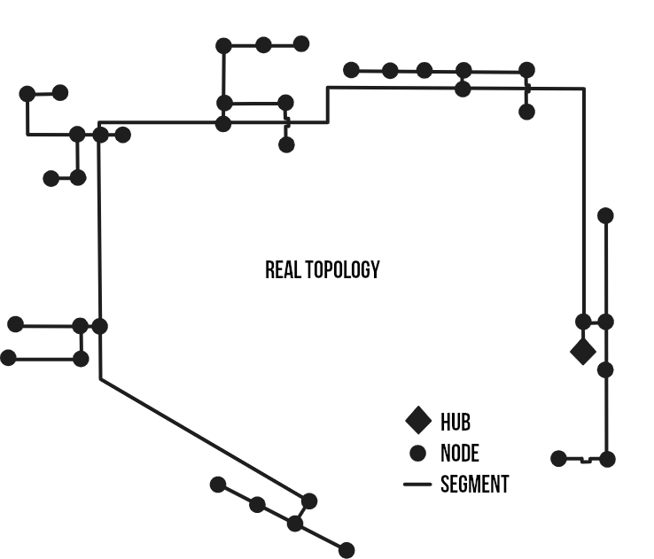
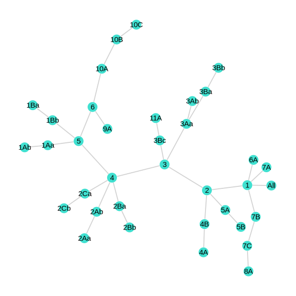
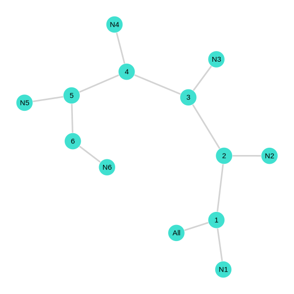
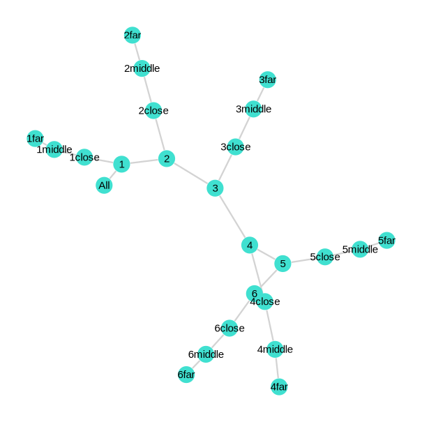

# Example of use

Here is a case example on how to use this tool. Let's say we want to size a heating network for the three accuracy approaches. Let's suppose the network topology is described by the following figure:



## 1. First step: Load the tool

First, make sure you have all the librairies used in PipingTool installed on your Julia.
```
Pkg.add CSV, DataFrames, NonlinearSolve, PrettyTables, Printf, Statistics, Unitful, DataStructures, OrderedCollections, PlotlyJS, GraphPlot, Graphs
```

Now, let's create a new file "myproject.jl" at the root of the tool. You should obtain a structure close to thise one:
```
docs/
Lib/
    functions.jl
    TopologyStruct.jl
    WaterProperties.jl
    Typical piping sizes and properties.csv
example.jl
myproject.jl
```

We will work in this new file. First of all, let's load all of the PipingTool functions.

```
# PipingTool Librairies
include("Lib/functions.jl")
import .func
# Librairies
using CSV, DataFrames, NonlinearSolve, PrettyTables, Printf, Statistics
using Unitful, DataStructures, OrderedCollections, PlotlyJS
using GraphPlot, Graphs, Compose, Cairo, Fontconfig
```

And finally, we'll give a name to this case study:
```
scenarioName = "example"   # Used as folder name in output directory.
```

## 2. Second step: Load your data

Now is the time to make sure you have loads file in the following format. Where in the first column are the timesteps, and each other columns represent the loads associated with a building/unit/whatever. Here is an example of load data CSV file:

| TIME   | LOADS_1 | LOADS_2 | ... | LOADS_N |
| ------ | ------- | ------- | --- | ------- |
| 1.0    | 0.0     | 0.0     | ... | 23456.0 |
| 2.0    | 0.0     | 0.0     | ... | 456567.0|
| 3.0    | 56780.0 | 0.0     | ... | 543466.0|
| ...    | ...     | ...     | ... | ...     |
| 8760.0 | 12306.0 | 0.0     | ... | 21786.0 |

Then, add this line so you can load the files using CSV reading function using `path_to_my_data` as your data's path.

```
data = CSV.read("path_to_my_data.csv", DataFrame, header=1, skipto=2)
```

## 3. Third step: Define the topology


Let's first add a few parameters line for the Energy hub (where the main plant will be) and the number of clusters:

```
# Principal parameters --------------------------
EnergyHub = "All"
nb_cluster = 6
ListOfNodes = names(select(data, Not(:TIME)))
```
Now, let's create the System object that will contain our network topology:

```
# Define Topology -------------------------------
Topology = func.TopologyStruct.System("TopologyDetailed",
                Vector{func.TopologyStruct.Node}(), 
                Vector{func.TopologyStruct.Segment}(),
                Vector{func.TopologyStruct.Segment}(),                   
                EnergyHub)
```

Then, we can define all the nodes by adding thoses lines:
```
# Define Nodes ----------------------------------
# Main loop nodes
func.TopologyStruct.add_new_node(Topology,EnergyHub,[], data)
func.TopologyStruct.add_new_node(Topology,"1", [], data)
func.TopologyStruct.add_new_node(Topology,"2", [], data)
func.TopologyStruct.add_new_node(Topology,"3", [], data)
func.TopologyStruct.add_new_node(Topology,"4", [], data)
func.TopologyStruct.add_new_node(Topology,"5", [], data)
func.TopologyStruct.add_new_node(Topology,"6", [], data)
# Building nodes
for i in 1:length(ListOfNodes)
    func.TopologyStruct.add_new_node(Topology, ListOfNodes[i], [ListOfNodes[i]], data)
end

```

Then, we can define all the segments by adding thoses lines:
```
# Define Segment --------------------------------
# Main supply
func.TopologyStruct.add_new_segment(Topology,EnergyHub, "1", 1)
func.TopologyStruct.add_new_segment(Topology,"1", "2", 425)
func.TopologyStruct.add_new_segment(Topology,"2", "3", 350)
func.TopologyStruct.add_new_segment(Topology,"3", "4", 200)
func.TopologyStruct.add_new_segment(Topology,"4", "5", 230)
func.TopologyStruct.add_new_segment(Topology,"5", "6", 375)

func.TopologyStruct.add_new_segment(Topology,"6", "9A", 70)
func.TopologyStruct.add_new_segment(Topology,"6", "10A", 60)
func.TopologyStruct.add_new_segment(Topology,"10A", "10B", 60)
func.TopologyStruct.add_new_segment(Topology,"10B", "10C", 60)

func.TopologyStruct.add_new_segment(Topology,"5", "1Aa", 100)
func.TopologyStruct.add_new_segment(Topology,"1Aa", "1Ab", 100)
func.TopologyStruct.add_new_segment(Topology,"5", "1Bb", 100)
func.TopologyStruct.add_new_segment(Topology,"1Bb", "1Ba", 100)

func.TopologyStruct.add_new_segment(Topology,"4", "2Ba", 30)
func.TopologyStruct.add_new_segment(Topology,"2Ba", "2Bb", 50)
func.TopologyStruct.add_new_segment(Topology,"4", "2Ca", 130)
func.TopologyStruct.add_new_segment(Topology,"2Ca", "2Cb", 40)
func.TopologyStruct.add_new_segment(Topology,"4", "2Ab", 60)
func.TopologyStruct.add_new_segment(Topology,"2Ab", "2Aa", 40)

func.TopologyStruct.add_new_segment(Topology,"3", "3Bc", 100)
func.TopologyStruct.add_new_segment(Topology,"3Bc", "11A", 50)
func.TopologyStruct.add_new_segment(Topology,"3", "3Aa", 100)
func.TopologyStruct.add_new_segment(Topology,"3Aa", "3Ab", 50)
func.TopologyStruct.add_new_segment(Topology,"3Aa", "3Ba", 50)
Topology= func.TopologyStruct.add_new_segment(Topology,"3Ba", "3Bb", 50)

func.TopologyStruct.add_new_segment(Topology,"2", "4B", 100)
func.TopologyStruct.add_new_segment(Topology,"4B", "4A", 50)
func.TopologyStruct.add_new_segment(Topology,"2", "5A", 120)
func.TopologyStruct.add_new_segment(Topology,"5A", "5B", 90)

func.TopologyStruct.add_new_segment(Topology,"1", "6A", 150)
func.TopologyStruct.add_new_segment(Topology,"1", "7A", 1)
func.TopologyStruct.add_new_segment(Topology,"1", "7B", 50)
func.TopologyStruct.add_new_segment(Topology,"7B", "7C", 120)
func.TopologyStruct.add_new_segment(Topology,"7C", "8A", 60)
```

Then, we can define all the clusters with the following lines:
```
# Define Cluster --------------------------------
func.TopologyStruct.add_new_cluster(Topology,"1")
func.TopologyStruct.add_new_cluster(Topology,"2")
func.TopologyStruct.add_new_cluster(Topology,"3")
func.TopologyStruct.add_new_cluster(Topology,"4")
func.TopologyStruct.add_new_cluster(Topology,"5")
func.TopologyStruct.add_new_cluster(Topology,"6")
```

Finally, we need to distribute the loads of each node to all the segments in their path to the energy hub. This is done with the following line:
```
# Distribute loads to Segments --------------------------------
func.TopologyStruct.get_SegmentLoads(Topology, EnergyHub)
```

And that's it ! You can wrap it up in a function if you want so you can call it whenever. And you can check your network in a beautiful graph with:

```
func.TopologyStruct.see_graph(Topology, scenarioName)
```

Here is what you should obtain:



## 4. Fourth step: Define network operation parameters

Before going to the actuals sizing and agregations algorithms, we need to define a few parameters for our next functions to work seamlessly. First, let's define our maximum authorized pressure drop in the network:

```
 Δp′_max = 220u"Pa/m"
```
Now let's define our network temperature for supply and return sides (we will also define temperature difference and mean temperature based our assumptions):
```
Ts = 75u"°C"
Tr = 45u"°C"
ΔT = Ts - Tr
T = Ts - ΔT/2
```

Finally, let's define a few variables for our CSV outputs files:
```
prefix = "H-"           # Used as a prefix before each segment names in the pipe characteristics CSV file.
colName = "QHEATTOT"    # Used as the column name of each clusters loads file.
append = false          # Used to indicate if we append or overwrite the pipe characterisation file.
```

Well, append is usually `false` except if you have a heating and cooling network, where you might want pipes to be stored in the same file for heating and cooling. If so, `append=false` for the first sizing with heating parameters/loads and `append=true` for second sizing with cooling parameters/loads.

## 5. Fifth step: Call sizing functions and agregation algorithm

Now it is time to add a few lines for the main functions. First here is how to call the sizing functions:

```
func.select_pipes(Topology, Ts, Tr, data, Δp′_max)
func.TopologyStruct.exportTopologySegment_ToCSV(Topology, scenarioName, prefix, append, colName)

```


Add those few lines to get the simplified equivalent network:
```
TopologySimplified = deepcopy(Topology)
TopologySimplified.Name = "TopologySimplified"

# Simpification algorithm
TopologySimplified = func.SimplifyingClusterAlgorithm(TopologySimplified)

# Save to CSV
func.TopologyStruct.see_graph(TopologySimplified, scenarioName)
func.TopologyStruct.exportTopologySegment_ToCSV(TopologySimplified, scenarioName, prefix, append, colName)

```
Here is what you should obtain:




Add those few lines to get the reduced equivalent network:
```
TopologyReduced = deepcopy(Topology)
TopologyReduced.Name = "TopologyReduced"

# Collapsing algorithm
TopologyReduced = func.CollapsingClusterAlgorithm(TopologyReduced, T)

# Reducing algorithm
TopologyReduced = func.ReductingClusterAlgorithm(TopologyReduced, T, ΔT)

# Save to CSV
func.TopologyStruct.see_graph(TopologyReduced, scenarioName)
func.TopologyStruct.exportTopologySegment_ToCSV(TopologyReduced, scenarioName, prefix, append, colName)
```
Here is what you should obtain:



