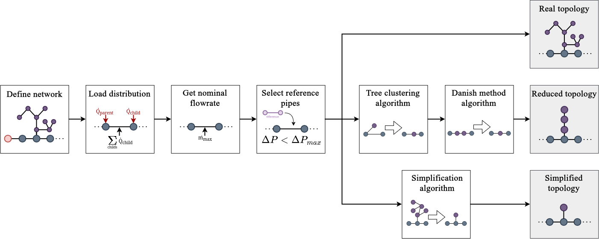
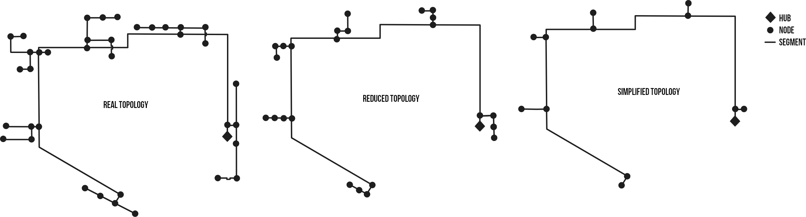

# Presentation of PipingTool

| Name        | PipingTool   |
| ----------- | ------------ |
| Version     | 3.0          |
| Authors     | MEUNIER G., KUMMERT M. |
| Licence     | MIT          |
| Last update | October 2026 |

### 1.1 Overview

PipingTool employs a network formalism inspired by directed graph theory and uses CSV files containing the load data for a site’s buildings and units to size all pipes for three levels of topological accuracy. Following figure provides an overview of the methodology used by this tool. 



The first step involves defining the network. Next, a series of steps is used to select pipes from a database [^1] that satisfy pressure loss constraints. This yields the sizing data for the network’s detailed topology. This is followed by two methods for aggregating/simplifying the topology in order to calculate equivalent pipes and obtain simplified network topologies. The simplified network model is based on two well-known algorithms for network aggregation: the tree-collapsing algorithm and the Danish method algorithm. The simplified model is based on the calculation of an equivalent node that preserves the sum of loads, pressure drops, and fluid volume. The following subsections present in greater detail each of the methodological steps briefly outlined in this introduction. For the three accuracy level, pipes characteristics and clusters loads are exported in CSV files.

### 1.2 Example of network

The following figure shows an exemple of a real network and its two equivalent network for the reduced method and the simplified method proposed in PipingTool.



### 1.3 Table of content

```@contents
```


[^1]: Nussbaumer et al., Handbook on Planning of District Heating Networks.